# 도감 인덱스 — BLENDER-1019 production kit

분야 → 품목 → 이미지·설명·파일. 경로는 이 폴더 기준. 보드: `previews/boards/`.

## 건축·장비·산업 자원 (62)

| ID | 이름 | 이미지 | 변형 | 파일 |
|---|---|---|---|---|
| Wood_Common | 일반 목재 | 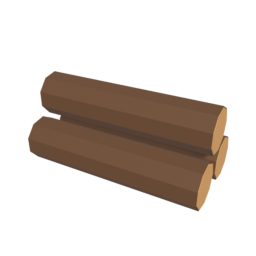 | single, stack | exports/resources/Wood_Common.fbx |
| Wood_Hard | 단단한 목재 |  | single, stack | exports/resources/Wood_Hard.fbx |
| Wood_Light | 가벼운 목재 | 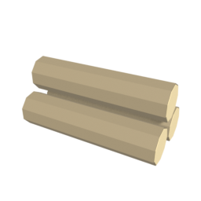 | single, stack | exports/resources/Wood_Light.fbx |
| Plank_Common | 일반 판재 |  | single, stack | exports/resources/Plank_Common.fbx |
| Plank_Hard | 단단한 판재 | 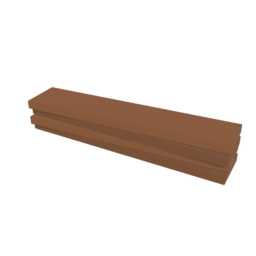 | single, stack | exports/resources/Plank_Hard.fbx |
| Plank_Light | 가벼운 판재 | 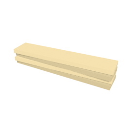 | single, stack | exports/resources/Plank_Light.fbx |
| Stone_Sandstone | 사암 돌덩어리 |  | single, stack | exports/resources/Stone_Sandstone.fbx |
| Stone_Granite | 화강암 돌덩어리 |  | single, stack | exports/resources/Stone_Granite.fbx |
| Stone_Marble | 대리석 돌덩어리 |  | single, stack | exports/resources/Stone_Marble.fbx |
| Stone_Tuff | 응회암 돌덩어리 | 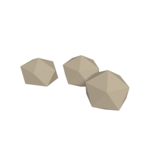 | single, stack | exports/resources/Stone_Tuff.fbx |
| Block_Sandstone | 사암 블록 |  | single, stack | exports/resources/Block_Sandstone.fbx |
| Block_Granite | 화강암 블록 | 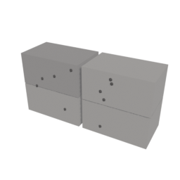 | single, stack | exports/resources/Block_Granite.fbx |
| Block_Marble | 대리석 블록 |  | single, stack | exports/resources/Block_Marble.fbx |
| Block_Tuff | 응회암 블록 | 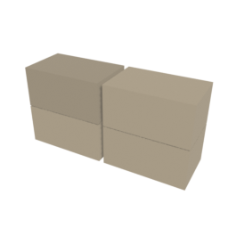 | single, stack | exports/resources/Block_Tuff.fbx |
| Ore_Copper | 구리광석 | 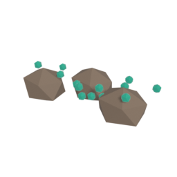 | single, stack | exports/resources/Ore_Copper.fbx |
| Ore_Tin | 주석광석 | 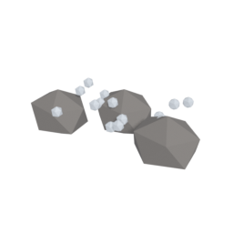 | single, stack | exports/resources/Ore_Tin.fbx |
| Ore_Iron | 철광석 | 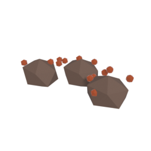 | single, stack | exports/resources/Ore_Iron.fbx |
| Ore_Silver | 은광석 | 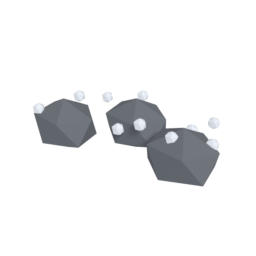 | single, stack | exports/resources/Ore_Silver.fbx |
| Ore_Gold | 금광석 | 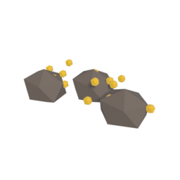 | single, stack | exports/resources/Ore_Gold.fbx |
| Ore_Titanium | 티타늄 광석 | 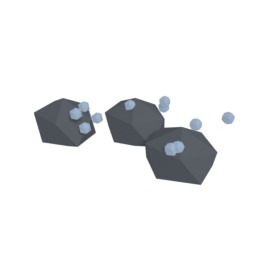 | single, stack | exports/resources/Ore_Titanium.fbx |
| Ore_Starlight | 성휘석(가칭) | 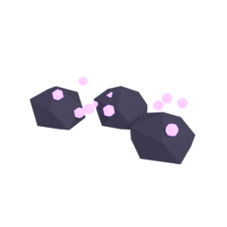 | single, stack | exports/resources/Ore_Starlight.fbx |
| Ingot_Copper | 구리 | 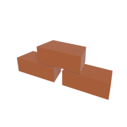 | single, stack | exports/resources/Ingot_Copper.fbx |
| Ingot_Tin | 주석 |  | single, stack | exports/resources/Ingot_Tin.fbx |
| Ingot_Bronze | 청동 |  | single, stack | exports/resources/Ingot_Bronze.fbx |
| Ingot_Iron | 철 | 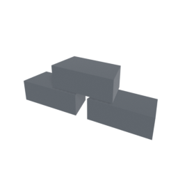 | single, stack | exports/resources/Ingot_Iron.fbx |
| Ingot_Steel | 강철 |  | single, stack | exports/resources/Ingot_Steel.fbx |
| Ingot_Silver | 은 | 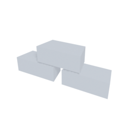 | single, stack | exports/resources/Ingot_Silver.fbx |
| Ingot_Gold | 금 | 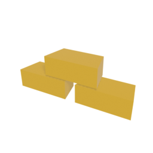 | single, stack | exports/resources/Ingot_Gold.fbx |
| Ingot_Titanium | 티타늄 | 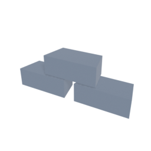 | single, stack | exports/resources/Ingot_Titanium.fbx |
| Ingot_TitaniumAlloy | 티타늄 합금 | 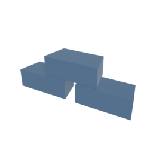 | single, stack | exports/resources/Ingot_TitaniumAlloy.fbx |
| Ingot_Starlight | 성휘금속(가칭) | 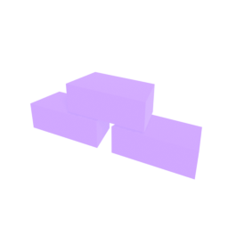 | single, stack | exports/resources/Ingot_Starlight.fbx |
| Ingot_StarlightAlloy | 성휘합금(가칭) | 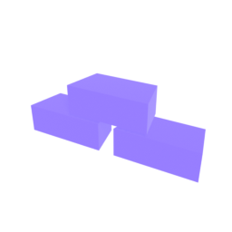 | single, stack | exports/resources/Ingot_StarlightAlloy.fbx |
| Fiber_Plant | 식물 섬유 | 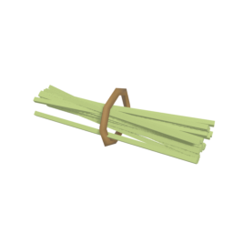 | single, stack | exports/resources/Fiber_Plant.fbx |
| Fiber_RanchYarn | 목장 실 |  | single, stack | exports/resources/Fiber_RanchYarn.fbx |
| Fiber_Wool | 털 |  | single, stack | exports/resources/Fiber_Wool.fbx |
| Cloth_Plant | 식물 직물 | 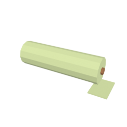 | single, stack | exports/resources/Cloth_Plant.fbx |
| Cloth_Yarn | 실 직물 |  | single, stack | exports/resources/Cloth_Yarn.fbx |
| Cloth_Wool | 털 직물 | 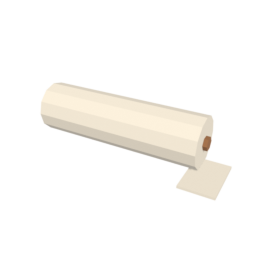 | single, stack | exports/resources/Cloth_Wool.fbx |
| Leather_Thin | 얇은 가죽 | 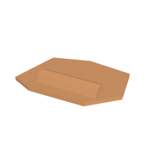 | single, stack | exports/resources/Leather_Thin.fbx |
| Leather_Thick | 두꺼운 가죽 | 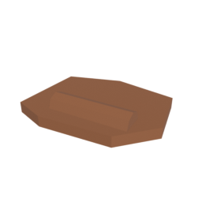 | single, stack | exports/resources/Leather_Thick.fbx |
| Leather_Fur | 모피 | 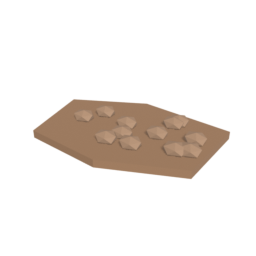 | single, stack | exports/resources/Leather_Fur.fbx |
| Fossil_Coal | 석탄 | 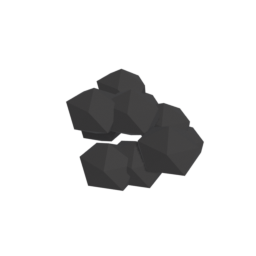 | single, stack | exports/resources/Fossil_Coal.fbx |
| Fossil_CrudeOil | 원유 | 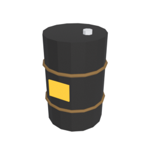 | single, stack | exports/resources/Fossil_CrudeOil.fbx |
| Fossil_NaturalGas | 천연가스 | 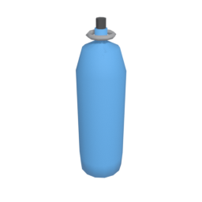 | single, stack | exports/resources/Fossil_NaturalGas.fbx |
| Mineral_Sand | 모래 | 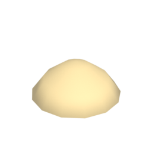 | single, stack | exports/resources/Mineral_Sand.fbx |
| Mineral_Clay | 점토 | 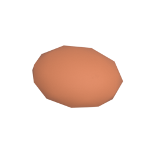 | single, stack | exports/resources/Mineral_Clay.fbx |
| Mineral_Limestone | 석회석 |  | single, stack | exports/resources/Mineral_Limestone.fbx |
| Mineral_Sulfur | 황 | 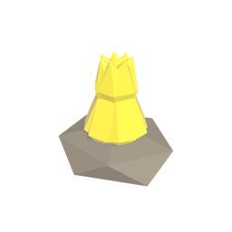 | single, stack | exports/resources/Mineral_Sulfur.fbx |
| Gather_Resin | 수지 | 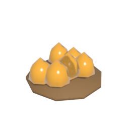 | single, stack | exports/resources/Gather_Resin.fbx |
| Gather_RubberSap | 천연고무 원료 수액 | 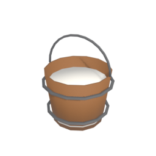 | single, stack | exports/resources/Gather_RubberSap.fbx |
| Byproduct_Straw | 짚 | 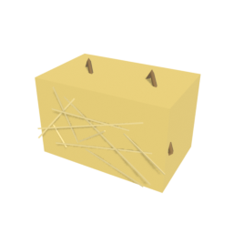 | single, stack | exports/resources/Byproduct_Straw.fbx |
| Byproduct_Manure | 동물 배설물 | 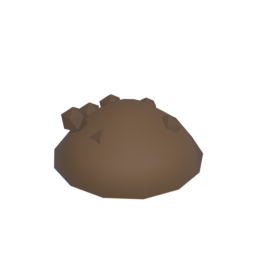 | single, stack | exports/resources/Byproduct_Manure.fbx |
| Proc_Charcoal | 숯 | 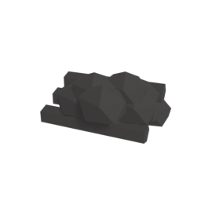 | single, stack | exports/resources/Proc_Charcoal.fbx |
| Proc_Coke | 코크스 | 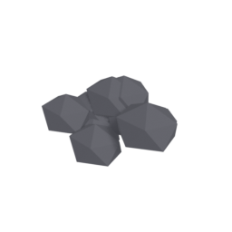 | single, stack | exports/resources/Proc_Coke.fbx |
| Proc_Fuel | 정제 연료 |  | single, stack | exports/resources/Proc_Fuel.fbx |
| Proc_Plastic | 플라스틱 | 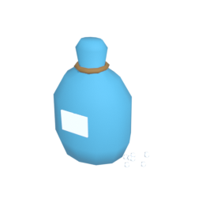 | single, stack | exports/resources/Proc_Plastic.fbx |
| Proc_Rubber | 고무 | 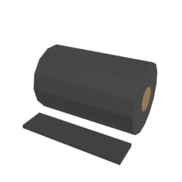 | single, stack | exports/resources/Proc_Rubber.fbx |
| Proc_Glass | 유리 | 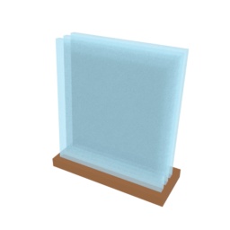 | single, stack | exports/resources/Proc_Glass.fbx |
| Proc_Brick | 벽돌 | 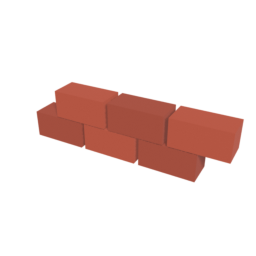 | single, stack | exports/resources/Proc_Brick.fbx |
| Proc_Pottery | 도자기 | 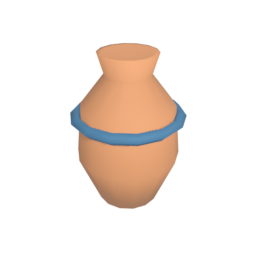 | single, stack | exports/resources/Proc_Pottery.fbx |
| Proc_Quicklime | 생석회 |  | single, stack | exports/resources/Proc_Quicklime.fbx |
| Proc_Compost | 퇴비 |  | single, stack | exports/resources/Proc_Compost.fbx |

## 곡물 (9)

| ID | 이름 | 이미지 | 변형 | 파일 |
|---|---|---|---|---|
| Grain_Rice | 쌀 |  | rotten, seed, single, stack | exports/resources/Grain_Rice.fbx |
| Grain_Wheat | 밀 |  | rotten, seed, single, stack | exports/resources/Grain_Wheat.fbx |
| Grain_Barley | 보리 |  | rotten, seed, single, stack | exports/resources/Grain_Barley.fbx |
| Grain_Corn | 옥수수 |  | rotten, seed, single, stack | exports/resources/Grain_Corn.fbx |
| Grain_Oat | 귀리 |  | rotten, seed, single, stack | exports/resources/Grain_Oat.fbx |
| Grain_Rye | 호밀 |  | rotten, seed, single, stack | exports/resources/Grain_Rye.fbx |
| Grain_Sorghum | 수수 |  | rotten, seed, single, stack | exports/resources/Grain_Sorghum.fbx |
| Grain_Millet | 기장 |  | rotten, seed, single, stack | exports/resources/Grain_Millet.fbx |
| Grain_Buckwheat | 메밀 |  | rotten, seed, single, stack | exports/resources/Grain_Buckwheat.fbx |

## 채소 (29)

| ID | 이름 | 이미지 | 변형 | 파일 |
|---|---|---|---|---|
| Veg_Potato | 감자 |  | rotten, seed, single, stack | exports/resources/Veg_Potato.fbx |
| Veg_Carrot | 당근 |  | rotten, seed, single, stack | exports/resources/Veg_Carrot.fbx |
| Veg_Cabbage | 양배추 |  | rotten, seed, single, stack | exports/resources/Veg_Cabbage.fbx |
| Veg_Pumpkin | 호박 |  | rotten, seed, single, stack | exports/resources/Veg_Pumpkin.fbx |
| Veg_Soybean | 콩 |  | rotten, seed, single, stack | exports/resources/Veg_Soybean.fbx |
| Veg_ChiliPepper | 고추 |  | rotten, seed, single, stack | exports/resources/Veg_ChiliPepper.fbx |
| Veg_SweetPotato | 고구마 |  | rotten, seed, single, stack | exports/resources/Veg_SweetPotato.fbx |
| Veg_Radish | 무 |  | rotten, seed, single, stack | exports/resources/Veg_Radish.fbx |
| Veg_Turnip | 순무 |  | rotten, seed, single, stack | exports/resources/Veg_Turnip.fbx |
| Veg_Beet | 비트 |  | rotten, seed, single, stack | exports/resources/Veg_Beet.fbx |
| Veg_Taro | 토란 |  | rotten, seed, single, stack | exports/resources/Veg_Taro.fbx |
| Veg_LotusRoot | 연근 |  | rotten, seed, single, stack | exports/resources/Veg_LotusRoot.fbx |
| Veg_NapaCabbage | 배추 |  | rotten, seed, single, stack | exports/resources/Veg_NapaCabbage.fbx |
| Veg_Spinach | 시금치 |  | rotten, seed, single, stack | exports/resources/Veg_Spinach.fbx |
| Veg_Lettuce | 상추 |  | rotten, seed, single, stack | exports/resources/Veg_Lettuce.fbx |
| Veg_Onion | 양파 |  | rotten, seed, single, stack | exports/resources/Veg_Onion.fbx |
| Veg_Leek | 대파 |  | rotten, seed, single, stack | exports/resources/Veg_Leek.fbx |
| Veg_Garlic | 마늘 |  | rotten, seed, single, stack | exports/resources/Veg_Garlic.fbx |
| Veg_Asparagus | 아스파라거스 |  | rotten, seed, single, stack | exports/resources/Veg_Asparagus.fbx |
| Veg_Tomato | 토마토 |  | rotten, seed, single, stack | exports/resources/Veg_Tomato.fbx |
| Veg_Cucumber | 오이 |  | rotten, seed, single, stack | exports/resources/Veg_Cucumber.fbx |
| Veg_Eggplant | 가지 |  | rotten, seed, single, stack | exports/resources/Veg_Eggplant.fbx |
| Veg_BellPepper | 피망 |  | rotten, seed, single, stack | exports/resources/Veg_BellPepper.fbx |
| Veg_Zucchini | 애호박 |  | rotten, seed, single, stack | exports/resources/Veg_Zucchini.fbx |
| Veg_Pea | 완두콩 |  | rotten, seed, single, stack | exports/resources/Veg_Pea.fbx |
| Veg_RedBean | 팥 |  | rotten, seed, single, stack | exports/resources/Veg_RedBean.fbx |
| Veg_KidneyBean | 강낭콩 |  | rotten, seed, single, stack | exports/resources/Veg_KidneyBean.fbx |
| Veg_Chickpea | 병아리콩 |  | rotten, seed, single, stack | exports/resources/Veg_Chickpea.fbx |
| Veg_Lentil | 렌틸콩 |  | rotten, seed, single, stack | exports/resources/Veg_Lentil.fbx |

## 과일·열매 (27)

| ID | 이름 | 이미지 | 변형 | 파일 |
|---|---|---|---|---|
| Fruit_Apple | 사과 |  | rotten, seed, single, stack | exports/resources/Fruit_Apple.fbx |
| Fruit_Pear | 배 |  | rotten, seed, single, stack | exports/resources/Fruit_Pear.fbx |
| Fruit_Grape | 포도 |  | rotten, seed, single, stack | exports/resources/Fruit_Grape.fbx |
| Fruit_Strawberry | 딸기 |  | rotten, seed, single, stack | exports/resources/Fruit_Strawberry.fbx |
| Fruit_WildBerry | 야생 열매 |  | rotten, single, stack | exports/resources/Fruit_WildBerry.fbx |
| Fruit_Peach | 복숭아 |  | rotten, seed, single, stack | exports/resources/Fruit_Peach.fbx |
| Fruit_Plum | 자두 |  | rotten, seed, single, stack | exports/resources/Fruit_Plum.fbx |
| Fruit_Apricot | 살구 |  | rotten, seed, single, stack | exports/resources/Fruit_Apricot.fbx |
| Fruit_Cherry | 체리 |  | rotten, seed, single, stack | exports/resources/Fruit_Cherry.fbx |
| Fruit_Persimmon | 감 |  | rotten, seed, single, stack | exports/resources/Fruit_Persimmon.fbx |
| Fruit_Pomegranate | 석류 |  | rotten, seed, single, stack | exports/resources/Fruit_Pomegranate.fbx |
| Fruit_Fig | 무화과 |  | rotten, seed, single, stack | exports/resources/Fruit_Fig.fbx |
| Fruit_Tangerine | 귤 |  | rotten, seed, single, stack | exports/resources/Fruit_Tangerine.fbx |
| Fruit_Orange | 오렌지 |  | rotten, seed, single, stack | exports/resources/Fruit_Orange.fbx |
| Fruit_Lemon | 레몬 |  | rotten, seed, single, stack | exports/resources/Fruit_Lemon.fbx |
| Fruit_Banana | 바나나 |  | rotten, seed, single, stack | exports/resources/Fruit_Banana.fbx |
| Fruit_Pineapple | 파인애플 |  | rotten, seed, single, stack | exports/resources/Fruit_Pineapple.fbx |
| Fruit_Mango | 망고 |  | rotten, seed, single, stack | exports/resources/Fruit_Mango.fbx |
| Fruit_Watermelon | 수박 |  | rotten, seed, single, stack | exports/resources/Fruit_Watermelon.fbx |
| Fruit_Melon | 멜론 |  | rotten, seed, single, stack | exports/resources/Fruit_Melon.fbx |
| Fruit_KoreanMelon | 참외 |  | rotten, seed, single, stack | exports/resources/Fruit_KoreanMelon.fbx |
| Fruit_Blueberry | 블루베리 |  | rotten, seed, single, stack | exports/resources/Fruit_Blueberry.fbx |
| Fruit_Raspberry | 라즈베리 |  | rotten, seed, single, stack | exports/resources/Fruit_Raspberry.fbx |
| Fruit_Blackberry | 블랙베리 |  | rotten, seed, single, stack | exports/resources/Fruit_Blackberry.fbx |
| Fruit_Cranberry | 크랜베리 |  | rotten, seed, single, stack | exports/resources/Fruit_Cranberry.fbx |
| Fruit_Mulberry | 오디 |  | rotten, seed, single, stack | exports/resources/Fruit_Mulberry.fbx |
| Fruit_Date | 대추야자 |  | rotten, seed, single, stack | exports/resources/Fruit_Date.fbx |

## 견과·씨앗 (8)

| ID | 이름 | 이미지 | 변형 | 파일 |
|---|---|---|---|---|
| Nut_Chestnut | 밤 |  | rotten, seed, single, stack | exports/resources/Nut_Chestnut.fbx |
| Nut_Walnut | 호두 |  | rotten, seed, single, stack | exports/resources/Nut_Walnut.fbx |
| Nut_Acorn | 도토리 |  | rotten, single, stack | exports/resources/Nut_Acorn.fbx |
| Nut_Almond | 아몬드 |  | rotten, seed, single, stack | exports/resources/Nut_Almond.fbx |
| Nut_PineNut | 잣 |  | single, stack | exports/resources/Nut_PineNut.fbx |
| Nut_Peanut | 땅콩 |  | rotten, seed, single, stack | exports/resources/Nut_Peanut.fbx |
| Nut_Sesame | 참깨 |  | seed, single, stack | exports/resources/Nut_Sesame.fbx |
| Nut_Sunflower | 해바라기씨 |  | seed, single, stack | exports/resources/Nut_Sunflower.fbx |

## 버섯 (11)

| ID | 이름 | 이미지 | 변형 | 파일 |
|---|---|---|---|---|
| Mush_Oyster | 느타리버섯 |  | rotten, single, stack | exports/resources/Mush_Oyster.fbx |
| Mush_Shiitake | 표고버섯 |  | rotten, single, stack | exports/resources/Mush_Shiitake.fbx |
| Mush_Button | 양송이버섯 |  | rotten, single, stack | exports/resources/Mush_Button.fbx |
| Mush_Matsutake | 송이버섯 |  | rotten, single, stack | exports/resources/Mush_Matsutake.fbx |
| Mush_Enoki | 팽이버섯 |  | rotten, single, stack | exports/resources/Mush_Enoki.fbx |
| Mush_KingOyster | 새송이버섯 |  | rotten, single, stack | exports/resources/Mush_KingOyster.fbx |
| Mush_WoodEar | 목이버섯 |  | rotten, single, stack | exports/resources/Mush_WoodEar.fbx |
| Mush_Shimeji | 만가닥버섯 |  | rotten, single, stack | exports/resources/Mush_Shimeji.fbx |
| Mush_Chanterelle | 살구버섯 |  | rotten, single, stack | exports/resources/Mush_Chanterelle.fbx |
| Mush_Morel | 곰보버섯 |  | rotten, single, stack | exports/resources/Mush_Morel.fbx |
| Mush_Truffle | 송로버섯 |  | rotten, single, stack | exports/resources/Mush_Truffle.fbx |

## 민물·바닷물고기 (16)

| ID | 이름 | 이미지 | 변형 | 파일 |
|---|---|---|---|---|
| Fish_Crucian | 붕어 |  | rotten, single, stack | exports/resources/Fish_Crucian.fbx |
| Fish_Carp | 잉어 |  | rotten, single, stack | exports/resources/Fish_Carp.fbx |
| Fish_Trout | 송어 |  | rotten, single, stack | exports/resources/Fish_Trout.fbx |
| Fish_Salmon | 연어 |  | rotten, single, stack | exports/resources/Fish_Salmon.fbx |
| Fish_Catfish | 메기 |  | rotten, single, stack | exports/resources/Fish_Catfish.fbx |
| Fish_Loach | 미꾸라지 |  | rotten, single, stack | exports/resources/Fish_Loach.fbx |
| Fish_Eel | 장어 |  | rotten, single, stack | exports/resources/Fish_Eel.fbx |
| Fish_Mandarin | 쏘가리 |  | rotten, single, stack | exports/resources/Fish_Mandarin.fbx |
| Fish_Smelt | 빙어 |  | rotten, single, stack | exports/resources/Fish_Smelt.fbx |
| Fish_Mackerel | 고등어 |  | rotten, single, stack | exports/resources/Fish_Mackerel.fbx |
| Fish_Herring | 청어 |  | rotten, single, stack | exports/resources/Fish_Herring.fbx |
| Fish_Cod | 대구 |  | rotten, single, stack | exports/resources/Fish_Cod.fbx |
| Fish_Tuna | 참치 |  | rotten, single, stack | exports/resources/Fish_Tuna.fbx |
| Fish_Sardine | 정어리 |  | rotten, single, stack | exports/resources/Fish_Sardine.fbx |
| Fish_Anchovy | 멸치 |  | rotten, single, stack | exports/resources/Fish_Anchovy.fbx |
| Fish_Flounder | 가자미 |  | rotten, single, stack | exports/resources/Fish_Flounder.fbx |

## 수산물 (13)

| ID | 이름 | 이미지 | 변형 | 파일 |
|---|---|---|---|---|
| Sea_Shrimp | 새우 |  | rotten, single, stack | exports/resources/Sea_Shrimp.fbx |
| Sea_Crab | 게 |  | rotten, single, stack | exports/resources/Sea_Crab.fbx |
| Sea_Crayfish | 가재 |  | rotten, single, stack | exports/resources/Sea_Crayfish.fbx |
| Sea_Squid | 오징어 |  | rotten, single, stack | exports/resources/Sea_Squid.fbx |
| Sea_Octopus | 문어 |  | rotten, single, stack | exports/resources/Sea_Octopus.fbx |
| Sea_Clam | 바지락 |  | rotten, single, stack | exports/resources/Sea_Clam.fbx |
| Sea_Mussel | 홍합 |  | rotten, single, stack | exports/resources/Sea_Mussel.fbx |
| Sea_Oyster | 굴 |  | rotten, single, stack | exports/resources/Sea_Oyster.fbx |
| Sea_Scallop | 가리비 |  | rotten, single, stack | exports/resources/Sea_Scallop.fbx |
| Sea_Abalone | 전복 |  | rotten, single, stack | exports/resources/Sea_Abalone.fbx |
| Sea_Laver | 김 |  | rotten, single, stack | exports/resources/Sea_Laver.fbx |
| Sea_Wakame | 미역 |  | rotten, single, stack | exports/resources/Sea_Wakame.fbx |
| Sea_Kelp | 다시마 |  | rotten, single, stack | exports/resources/Sea_Kelp.fbx |

## 고기 (11)

| ID | 이름 | 이미지 | 변형 | 파일 |
|---|---|---|---|---|
| Meat_Rabbit | 토끼고기 |  | rotten, single, stack | exports/resources/Meat_Rabbit.fbx |
| Meat_Boar | 멧돼지고기 |  | rotten, single, stack | exports/resources/Meat_Boar.fbx |
| Meat_Venison | 사슴고기 |  | rotten, single, stack | exports/resources/Meat_Venison.fbx |
| Meat_Bird | 새고기 |  | rotten, single, stack | exports/resources/Meat_Bird.fbx |
| Meat_Insect | 곤충고기 |  | rotten, single, stack | exports/resources/Meat_Insect.fbx |
| Meat_Chicken | 닭고기 |  | rotten, single, stack | exports/resources/Meat_Chicken.fbx |
| Meat_Duck | 오리고기 |  | rotten, single, stack | exports/resources/Meat_Duck.fbx |
| Meat_Goose | 거위고기 |  | rotten, single, stack | exports/resources/Meat_Goose.fbx |
| Meat_Beef | 소고기 |  | rotten, single, stack | exports/resources/Meat_Beef.fbx |
| Meat_Mutton | 양고기 |  | rotten, single, stack | exports/resources/Meat_Mutton.fbx |
| Meat_Goat | 염소고기 |  | rotten, single, stack | exports/resources/Meat_Goat.fbx |

## 식용 곤충 (3)

| ID | 이름 | 이미지 | 변형 | 파일 |
|---|---|---|---|---|
| Insect_Cricket | 귀뚜라미 |  | rotten, single, stack | exports/resources/Insect_Cricket.fbx |
| Insect_Grasshopper | 메뚜기 |  | rotten, single, stack | exports/resources/Insect_Grasshopper.fbx |
| Insect_Larva | 식용 애벌레 |  | rotten, single, stack | exports/resources/Insect_Larva.fbx |

## 목장·기타 식품 (9)

| ID | 이름 | 이미지 | 변형 | 파일 |
|---|---|---|---|---|
| Ranch_Egg | 알 |  | rotten, single, stack | exports/resources/Ranch_Egg.fbx |
| Ranch_ChickenEgg | 닭알 |  | rotten, single, stack | exports/resources/Ranch_ChickenEgg.fbx |
| Ranch_DuckEgg | 오리알 |  | rotten, single, stack | exports/resources/Ranch_DuckEgg.fbx |
| Ranch_QuailEgg | 메추리알 |  | rotten, single, stack | exports/resources/Ranch_QuailEgg.fbx |
| Ranch_Milk | 우유 |  | rotten, single, stack | exports/resources/Ranch_Milk.fbx |
| Ranch_GoatMilk | 염소젖 |  | rotten, single, stack | exports/resources/Ranch_GoatMilk.fbx |
| Ranch_Honeydew | 감로 |  | rotten, single, stack | exports/resources/Ranch_Honeydew.fbx |
| Ranch_Honey | 꿀 |  | single, stack | exports/resources/Ranch_Honey.fbx |
| Ranch_Salt | 소금 |  | single, stack | exports/resources/Ranch_Salt.fbx |

## 특용·향신·기호 작물 (14)

| ID | 이름 | 이미지 | 변형 | 파일 |
|---|---|---|---|---|
| Crop_Cotton | 목화 |  | seed, single, stack | exports/resources/Crop_Cotton.fbx |
| Crop_Flax | 아마 |  | seed, single, stack | exports/resources/Crop_Flax.fbx |
| Crop_Herb | 약초 |  | rotten, seed, single, stack | exports/resources/Crop_Herb.fbx |
| Crop_Sugarcane | 사탕수수 |  | rotten, seed, single, stack | exports/resources/Crop_Sugarcane.fbx |
| Crop_SugarBeet | 사탕무 |  | rotten, seed, single, stack | exports/resources/Crop_SugarBeet.fbx |
| Crop_MapleSap | 단풍 수액 |  | single, stack | exports/resources/Crop_MapleSap.fbx |
| Crop_Ginger | 생강 |  | rotten, seed, single, stack | exports/resources/Crop_Ginger.fbx |
| Crop_Pepper | 후추 |  | seed, single, stack | exports/resources/Crop_Pepper.fbx |
| Crop_Basil | 바질 |  | rotten, seed, single, stack | exports/resources/Crop_Basil.fbx |
| Crop_Mint | 박하 |  | rotten, seed, single, stack | exports/resources/Crop_Mint.fbx |
| Crop_Cinnamon | 계피 |  | single, stack | exports/resources/Crop_Cinnamon.fbx |
| Crop_TeaLeaf | 찻잎 |  | rotten, seed, single, stack | exports/resources/Crop_TeaLeaf.fbx |
| Crop_CoffeeCherry | 커피 열매 |  | rotten, seed, single, stack | exports/resources/Crop_CoffeeCherry.fbx |
| Crop_CacaoPod | 카카오 열매 |  | rotten, seed, single, stack | exports/resources/Crop_CacaoPod.fbx |

## 가공 식품 (34)

| ID | 이름 | 이미지 | 변형 | 파일 |
|---|---|---|---|---|
| Proc_WheatFlour | 밀가루 |  | single, stack | exports/resources/Proc_WheatFlour.fbx |
| Proc_RyeFlour | 호밀가루 |  | single, stack | exports/resources/Proc_RyeFlour.fbx |
| Proc_BuckwheatFlour | 메밀가루 |  | single, stack | exports/resources/Proc_BuckwheatFlour.fbx |
| Proc_CornFlour | 옥수수가루 |  | single, stack | exports/resources/Proc_CornFlour.fbx |
| Proc_CookingOil | 식용유 |  | single, stack | exports/resources/Proc_CookingOil.fbx |
| Proc_SoybeanOil | 콩기름 |  | single, stack | exports/resources/Proc_SoybeanOil.fbx |
| Proc_SesameOil | 참기름 |  | single, stack | exports/resources/Proc_SesameOil.fbx |
| Proc_SunflowerOil | 해바라기유 |  | single, stack | exports/resources/Proc_SunflowerOil.fbx |
| Proc_Tofu | 두부 |  | rotten, single, stack | exports/resources/Proc_Tofu.fbx |
| Proc_SoyMilk | 두유 |  | rotten, single, stack | exports/resources/Proc_SoyMilk.fbx |
| Proc_Butter | 버터 |  | rotten, single, stack | exports/resources/Proc_Butter.fbx |
| Proc_Cheese | 치즈 |  | rotten, single, stack | exports/resources/Proc_Cheese.fbx |
| Proc_Yogurt | 요구르트 |  | rotten, single, stack | exports/resources/Proc_Yogurt.fbx |
| Proc_Cream | 크림 |  | rotten, single, stack | exports/resources/Proc_Cream.fbx |
| Proc_Sugar | 설탕 |  | single, stack | exports/resources/Proc_Sugar.fbx |
| Proc_Molasses | 당밀 |  | single, stack | exports/resources/Proc_Molasses.fbx |
| Proc_MapleSyrup | 단풍 시럽 |  | single, stack | exports/resources/Proc_MapleSyrup.fbx |
| Proc_DriedFruit | 말린 과일 |  | single, stack | exports/resources/Proc_DriedFruit.fbx |
| Proc_DriedMushroom | 말린 버섯 |  | single, stack | exports/resources/Proc_DriedMushroom.fbx |
| Proc_Jerky | 육포 |  | single, stack | exports/resources/Proc_Jerky.fbx |
| Proc_DriedFish | 말린 생선 |  | single, stack | exports/resources/Proc_DriedFish.fbx |
| Proc_SmokedMeat | 훈제 고기 |  | rotten, single, stack | exports/resources/Proc_SmokedMeat.fbx |
| Proc_SmokedFish | 훈제 생선 |  | rotten, single, stack | exports/resources/Proc_SmokedFish.fbx |
| Proc_SaltedMeat | 염장 고기 |  | rotten, single, stack | exports/resources/Proc_SaltedMeat.fbx |
| Proc_SaltedFish | 염장 생선 |  | rotten, single, stack | exports/resources/Proc_SaltedFish.fbx |
| Proc_Jam | 과일잼 |  | rotten, single, stack | exports/resources/Proc_Jam.fbx |
| Proc_Pickles | 채소 절임 |  | rotten, single, stack | exports/resources/Proc_Pickles.fbx |
| Proc_Canned | 통조림 |  | single, stack | exports/resources/Proc_Canned.fbx |
| Proc_Vinegar | 식초 |  | single, stack | exports/resources/Proc_Vinegar.fbx |
| Proc_SoySauce | 간장 |  | single, stack | exports/resources/Proc_SoySauce.fbx |
| Proc_Doenjang | 된장 |  | single, stack | exports/resources/Proc_Doenjang.fbx |
| Proc_RoastedCoffee | 볶은 커피콩 |  | single, stack | exports/resources/Proc_RoastedCoffee.fbx |
| Proc_CocoaPowder | 코코아 가루 |  | single, stack | exports/resources/Proc_CocoaPowder.fbx |
| Proc_Malt | 맥아 |  | single, stack | exports/resources/Proc_Malt.fbx |

## 요리·음료 (53)

| ID | 이름 | 이미지 | 변형 | 파일 |
|---|---|---|---|---|
| Dish_Rice | 밥 |  | rotten, single, stack | exports/resources/Dish_Rice.fbx |
| Dish_MultigrainRice | 잡곡밥 |  | rotten, single, stack | exports/resources/Dish_MultigrainRice.fbx |
| Dish_Porridge | 죽 |  | rotten, single, stack | exports/resources/Dish_Porridge.fbx |
| Dish_FriedRice | 볶음밥 |  | rotten, single, stack | exports/resources/Dish_FriedRice.fbx |
| Dish_RiceBall | 주먹밥 |  | rotten, single, stack | exports/resources/Dish_RiceBall.fbx |
| Dish_RiceBowl | 덮밥 |  | rotten, single, stack | exports/resources/Dish_RiceBowl.fbx |
| Bread_Flat | 납작빵 |  | rotten, single, stack | exports/resources/Bread_Flat.fbx |
| Bread_Loaf | 식빵 |  | rotten, single, stack | exports/resources/Bread_Loaf.fbx |
| Bread_Rye | 호밀빵 |  | rotten, single, stack | exports/resources/Bread_Rye.fbx |
| Bread_Corn | 옥수수빵 |  | rotten, single, stack | exports/resources/Bread_Corn.fbx |
| Pie_Meat | 고기파이 |  | rotten, single, stack | exports/resources/Pie_Meat.fbx |
| Pie_Fruit | 과일파이 |  | rotten, single, stack | exports/resources/Pie_Fruit.fbx |
| Noodle_Plain | 국수 |  | rotten, single, stack | exports/resources/Noodle_Plain.fbx |
| Noodle_Fried | 볶음국수 |  | rotten, single, stack | exports/resources/Noodle_Fried.fbx |
| Noodle_Meat | 고기국수 |  | rotten, single, stack | exports/resources/Noodle_Meat.fbx |
| Noodle_Buckwheat | 메밀국수 |  | rotten, single, stack | exports/resources/Noodle_Buckwheat.fbx |
| Soup_Vegetable | 채소 수프 |  | rotten, single, stack | exports/resources/Soup_Vegetable.fbx |
| Soup_Mushroom | 버섯 수프 |  | rotten, single, stack | exports/resources/Soup_Mushroom.fbx |
| Soup_Fish | 생선탕 |  | rotten, single, stack | exports/resources/Soup_Fish.fbx |
| Stew_Meat | 고기 스튜 |  | rotten, single, stack | exports/resources/Stew_Meat.fbx |
| Stew_Bean | 콩 스튜 |  | rotten, single, stack | exports/resources/Stew_Bean.fbx |
| Veg_Salad | 샐러드 |  | rotten, single, stack | exports/resources/Veg_Salad.fbx |
| Veg_Roasted | 구운 채소 |  | rotten, single, stack | exports/resources/Veg_Roasted.fbx |
| Veg_StirFry | 채소볶음 |  | rotten, single, stack | exports/resources/Veg_StirFry.fbx |
| Veg_Pancake | 채소전 |  | rotten, single, stack | exports/resources/Veg_Pancake.fbx |
| Veg_BraisedTofu | 두부조림 |  | rotten, single, stack | exports/resources/Veg_BraisedTofu.fbx |
| Meat_Roast | 구운 고기 |  | rotten, single, stack | exports/resources/Meat_Roast.fbx |
| Meat_Skewer | 꼬치구이 |  | rotten, single, stack | exports/resources/Meat_Skewer.fbx |
| Meat_StirFry | 고기볶음 |  | rotten, single, stack | exports/resources/Meat_StirFry.fbx |
| Meat_Meatball | 완자 |  | rotten, single, stack | exports/resources/Meat_Meatball.fbx |
| Meat_Steamed | 고기찜 |  | rotten, single, stack | exports/resources/Meat_Steamed.fbx |
| Fish_Grilled | 생선구이 |  | rotten, single, stack | exports/resources/Fish_Grilled.fbx |
| Fish_Steamed | 생선찜 |  | rotten, single, stack | exports/resources/Fish_Steamed.fbx |
| Fish_Fried | 생선튀김 |  | rotten, single, stack | exports/resources/Fish_Fried.fbx |
| Sea_StirFry | 해물볶음 |  | rotten, single, stack | exports/resources/Sea_StirFry.fbx |
| Sea_ClamSoup | 조개 수프 |  | rotten, single, stack | exports/resources/Sea_ClamSoup.fbx |
| Egg_Boiled | 삶은 알 |  | rotten, single, stack | exports/resources/Egg_Boiled.fbx |
| Egg_Fried | 알프라이 |  | rotten, single, stack | exports/resources/Egg_Fried.fbx |
| Egg_Omelette | 오믈렛 |  | rotten, single, stack | exports/resources/Egg_Omelette.fbx |
| Egg_Steamed | 알찜 |  | rotten, single, stack | exports/resources/Egg_Steamed.fbx |
| Insect_Fried | 볶은 귀뚜라미 |  | rotten, single, stack | exports/resources/Insect_Fried.fbx |
| Insect_Skewer | 메뚜기 꼬치 |  | rotten, single, stack | exports/resources/Insect_Skewer.fbx |
| Insect_Grilled | 애벌레 구이 |  | rotten, single, stack | exports/resources/Insect_Grilled.fbx |
| Dessert_FruitSalad | 과일 샐러드 |  | rotten, single, stack | exports/resources/Dessert_FruitSalad.fbx |
| Dessert_Cookie | 쿠키 |  | rotten, single, stack | exports/resources/Dessert_Cookie.fbx |
| Dessert_Cake | 케이크 |  | rotten, single, stack | exports/resources/Dessert_Cake.fbx |
| Dessert_Pudding | 푸딩 |  | rotten, single, stack | exports/resources/Dessert_Pudding.fbx |
| Dessert_Pancake | 팬케이크 |  | rotten, single, stack | exports/resources/Dessert_Pancake.fbx |
| Dessert_NutBar | 견과바 |  | rotten, single, stack | exports/resources/Dessert_NutBar.fbx |
| Drink_Tea | 차 |  | rotten, single, stack | exports/resources/Drink_Tea.fbx |
| Drink_Coffee | 커피 |  | rotten, single, stack | exports/resources/Drink_Coffee.fbx |
| Drink_FruitJuice | 과일주스 |  | rotten, single, stack | exports/resources/Drink_FruitJuice.fbx |
| Drink_Cocoa | 코코아 |  | rotten, single, stack | exports/resources/Drink_Cocoa.fbx |

## 술 (6)

| ID | 이름 | 이미지 | 변형 | 파일 |
|---|---|---|---|---|
| Alc_Beer | 맥주 |  | single, stack | exports/resources/Alc_Beer.fbx |
| Alc_RiceWine | 쌀술 |  | single, stack | exports/resources/Alc_RiceWine.fbx |
| Alc_FruitWine | 과실주 |  | single, stack | exports/resources/Alc_FruitWine.fbx |
| Alc_Mead | 벌꿀주 |  | single, stack | exports/resources/Alc_Mead.fbx |
| Alc_HoneydewWine | 감로주 |  | single, stack | exports/resources/Alc_HoneydewWine.fbx |
| Alc_Spirits | 증류주 |  | single, stack | exports/resources/Alc_Spirits.fbx |

## 밭 작물 성장 단계

| ID | 이름 | 단계 이미지(S1–S5) | 형태 |
|---|---|---|---|
| Grain_Rice | 쌀 |  | grass |
| Grain_Wheat | 밀 |  | grass |
| Grain_Barley | 보리 |  | grass |
| Grain_Corn | 옥수수 |  | stalk |
| Grain_Oat | 귀리 |  | grass |
| Grain_Rye | 호밀 |  | grass |
| Grain_Sorghum | 수수 |  | stalk |
| Grain_Millet | 기장 |  | grass |
| Grain_Buckwheat | 메밀 |  | rosette |
| Veg_Potato | 감자 |  | bush |
| Veg_Carrot | 당근 |  | rosette |
| Veg_Cabbage | 양배추 |  | rosette |
| Veg_Pumpkin | 호박 |  | bush |
| Veg_Soybean | 콩 |  | bush |
| Veg_ChiliPepper | 고추 |  | bush |
| Veg_SweetPotato | 고구마 |  | bush |
| Veg_Radish | 무 |  | rosette |
| Veg_Turnip | 순무 |  | rosette |
| Veg_Beet | 비트 |  | rosette |
| Veg_Taro | 토란 |  | rosette |
| Veg_LotusRoot | 연근 |  | rosette |
| Veg_NapaCabbage | 배추 |  | rosette |
| Veg_Spinach | 시금치 |  | rosette |
| Veg_Lettuce | 상추 |  | rosette |
| Veg_Onion | 양파 |  | rosette |
| Veg_Leek | 대파 |  | rosette |
| Veg_Garlic | 마늘 |  | rosette |
| Veg_Asparagus | 아스파라거스 |  | rosette |
| Veg_Tomato | 토마토 |  | bush |
| Veg_Cucumber | 오이 |  | bush |
| Veg_Eggplant | 가지 |  | bush |
| Veg_BellPepper | 피망 |  | bush |
| Veg_Zucchini | 애호박 |  | bush |
| Veg_Pea | 완두콩 |  | bush |
| Veg_RedBean | 팥 |  | bush |
| Veg_KidneyBean | 강낭콩 |  | bush |
| Veg_Chickpea | 병아리콩 |  | bush |
| Veg_Lentil | 렌틸콩 |  | bush |
| Fruit_Apple | 사과 |  | tree |
| Fruit_Pear | 배 |  | tree |
| Fruit_Grape | 포도 |  | bush |
| Fruit_Strawberry | 딸기 |  | bush |
| Fruit_Peach | 복숭아 |  | tree |
| Fruit_Plum | 자두 |  | tree |
| Fruit_Apricot | 살구 |  | tree |
| Fruit_Cherry | 체리 |  | tree |
| Fruit_Persimmon | 감 |  | tree |
| Fruit_Pomegranate | 석류 |  | tree |
| Fruit_Fig | 무화과 |  | tree |
| Fruit_Tangerine | 귤 |  | tree |
| Fruit_Orange | 오렌지 |  | tree |
| Fruit_Lemon | 레몬 |  | tree |
| Fruit_Banana | 바나나 |  | tree |
| Fruit_Pineapple | 파인애플 |  | rosette |
| Fruit_Mango | 망고 |  | tree |
| Fruit_Watermelon | 수박 |  | bush |
| Fruit_Melon | 멜론 |  | bush |
| Fruit_KoreanMelon | 참외 |  | bush |
| Fruit_Blueberry | 블루베리 |  | bush |
| Fruit_Raspberry | 라즈베리 |  | bush |
| Fruit_Blackberry | 블랙베리 |  | bush |
| Fruit_Cranberry | 크랜베리 |  | bush |
| Fruit_Mulberry | 오디 |  | tree |
| Fruit_Date | 대추야자 |  | tree |
| Nut_Chestnut | 밤 |  | tree |
| Nut_Walnut | 호두 |  | tree |
| Nut_Almond | 아몬드 |  | tree |
| Nut_Peanut | 땅콩 |  | bush |
| Nut_Sesame | 참깨 |  | rosette |
| Nut_Sunflower | 해바라기씨 |  | stalk |
| Crop_Cotton | 목화 |  | bush |
| Crop_Flax | 아마 |  | grass |
| Crop_Herb | 약초 |  | rosette |
| Crop_Sugarcane | 사탕수수 |  | stalk |
| Crop_SugarBeet | 사탕무 |  | rosette |
| Crop_Ginger | 생강 |  | rosette |
| Crop_Pepper | 후추 |  | bush |
| Crop_Basil | 바질 |  | rosette |
| Crop_Mint | 박하 |  | rosette |
| Crop_TeaLeaf | 찻잎 |  | tree |
| Crop_CoffeeCherry | 커피 열매 |  | tree |
| Crop_CacaoPod | 카카오 열매 |  | tree |

## 도구·무기 (재질 단계)

| ID | 이름 | 이미지 | 소켓 |
|---|---|---|---|
| Tool_Pickaxe_Stone | 곡괭이 (돌) |  | Socket.Tool.R |
| Tool_Pickaxe_Copper | 곡괭이 (구리) |  | Socket.Tool.R |
| Tool_Pickaxe_Bronze | 곡괭이 (청동) |  | Socket.Tool.R |
| Tool_Pickaxe_Iron | 곡괭이 (철) |  | Socket.Tool.R |
| Tool_Pickaxe_Steel | 곡괭이 (강철) |  | Socket.Tool.R |
| Tool_Pickaxe_Titanium | 곡괭이 (티타늄 합금) |  | Socket.Tool.R |
| Tool_Pickaxe_Starlight | 곡괭이 (성휘합금(가칭)) |  | Socket.Tool.R |
| Tool_Axe_Stone | 도끼 (돌) |  | Socket.Tool.R |
| Tool_Axe_Copper | 도끼 (구리) |  | Socket.Tool.R |
| Tool_Axe_Bronze | 도끼 (청동) |  | Socket.Tool.R |
| Tool_Axe_Iron | 도끼 (철) |  | Socket.Tool.R |
| Tool_Axe_Steel | 도끼 (강철) |  | Socket.Tool.R |
| Tool_Axe_Titanium | 도끼 (티타늄 합금) |  | Socket.Tool.R |
| Tool_Axe_Starlight | 도끼 (성휘합금(가칭)) |  | Socket.Tool.R |
| Tool_Shovel_Stone | 삽 (돌) |  | Socket.Tool.R |
| Tool_Shovel_Copper | 삽 (구리) |  | Socket.Tool.R |
| Tool_Shovel_Bronze | 삽 (청동) |  | Socket.Tool.R |
| Tool_Shovel_Iron | 삽 (철) |  | Socket.Tool.R |
| Tool_Shovel_Steel | 삽 (강철) |  | Socket.Tool.R |
| Tool_Shovel_Titanium | 삽 (티타늄 합금) |  | Socket.Tool.R |
| Tool_Shovel_Starlight | 삽 (성휘합금(가칭)) |  | Socket.Tool.R |
| Tool_Hammer_Stone | 망치 (돌) |  | Socket.Tool.R |
| Tool_Hammer_Copper | 망치 (구리) |  | Socket.Tool.R |
| Tool_Hammer_Bronze | 망치 (청동) |  | Socket.Tool.R |
| Tool_Hammer_Iron | 망치 (철) |  | Socket.Tool.R |
| Tool_Hammer_Steel | 망치 (강철) |  | Socket.Tool.R |
| Tool_Hammer_Titanium | 망치 (티타늄 합금) |  | Socket.Tool.R |
| Tool_Hammer_Starlight | 망치 (성휘합금(가칭)) |  | Socket.Tool.R |
| Tool_Hoe_Stone | 괭이 (돌) |  | Socket.Tool.R |
| Tool_Hoe_Copper | 괭이 (구리) |  | Socket.Tool.R |
| Tool_Hoe_Bronze | 괭이 (청동) |  | Socket.Tool.R |
| Tool_Hoe_Iron | 괭이 (철) |  | Socket.Tool.R |
| Tool_Hoe_Steel | 괭이 (강철) |  | Socket.Tool.R |
| Tool_Hoe_Titanium | 괭이 (티타늄 합금) |  | Socket.Tool.R |
| Tool_Hoe_Starlight | 괭이 (성휘합금(가칭)) |  | Socket.Tool.R |
| Tool_Sickle_Stone | 낫 (돌) |  | Socket.Tool.R |
| Tool_Sickle_Copper | 낫 (구리) |  | Socket.Tool.R |
| Tool_Sickle_Bronze | 낫 (청동) |  | Socket.Tool.R |
| Tool_Sickle_Iron | 낫 (철) |  | Socket.Tool.R |
| Tool_Sickle_Steel | 낫 (강철) |  | Socket.Tool.R |
| Tool_Sickle_Titanium | 낫 (티타늄 합금) |  | Socket.Tool.R |
| Tool_Sickle_Starlight | 낫 (성휘합금(가칭)) |  | Socket.Tool.R |
| Weapon_Sword_Copper | 검 (구리) |  | Socket.Tool.R |
| Weapon_Sword_Bronze | 검 (청동) |  | Socket.Tool.R |
| Weapon_Sword_Iron | 검 (철) |  | Socket.Tool.R |
| Weapon_Sword_Steel | 검 (강철) |  | Socket.Tool.R |
| Weapon_Sword_Titanium | 검 (티타늄 합금) |  | Socket.Tool.R |
| Weapon_Sword_Starlight | 검 (성휘합금(가칭)) |  | Socket.Tool.R |
| Weapon_Spear_Copper | 창 (구리) |  | Socket.Tool.R |
| Weapon_Spear_Bronze | 창 (청동) |  | Socket.Tool.R |
| Weapon_Spear_Iron | 창 (철) |  | Socket.Tool.R |
| Weapon_Spear_Steel | 창 (강철) |  | Socket.Tool.R |
| Weapon_Spear_Titanium | 창 (티타늄 합금) |  | Socket.Tool.R |
| Weapon_Spear_Starlight | 창 (성휘합금(가칭)) |  | Socket.Tool.R |
| Weapon_Shield_Copper | 방패 (구리) |  | Socket.Tool.L |
| Weapon_Shield_Bronze | 방패 (청동) |  | Socket.Tool.L |
| Weapon_Shield_Iron | 방패 (철) |  | Socket.Tool.L |
| Weapon_Shield_Steel | 방패 (강철) |  | Socket.Tool.L |
| Weapon_Shield_Titanium | 방패 (티타늄 합금) |  | Socket.Tool.L |
| Weapon_Shield_Starlight | 방패 (성휘합금(가칭)) |  | Socket.Tool.L |
| Scabbard_Copper | 칼집 (구리) |  | Socket.Hip.R via Holder_Sword (carry-placement.json) |
| Scabbard_Bronze | 칼집 (청동) |  | Socket.Hip.R via Holder_Sword (carry-placement.json) |
| Scabbard_Iron | 칼집 (철) |  | Socket.Hip.R via Holder_Sword (carry-placement.json) |
| Scabbard_Steel | 칼집 (강철) |  | Socket.Hip.R via Holder_Sword (carry-placement.json) |
| Scabbard_Titanium | 칼집 (티타늄 합금) |  | Socket.Hip.R via Holder_Sword (carry-placement.json) |
| Scabbard_Starlight | 칼집 (성휘합금(가칭)) |  | Socket.Hip.R via Holder_Sword (carry-placement.json) |

## 시설·배관·매장 지점

| ID | 이름 | 이미지 | 분류 | 설명 |
|---|---|---|---|---|
| SewingTable | 재봉 작업대 |  | 기초 가공 | 천·가죽 제작과 수리. 작업물은 상판 위에 놓인 별도 물건 |
| CharcoalKiln | 숯가마 |  | 제련·장비 | 목재 → 숯. 앞문으로 장작 투입, 숯은 앞 바닥에 배출 |
| Blacksmith | 대장간 |  | 제련·장비 | 금속 장비 제작·수리. 작업물은 모루 위에 고정, 망치 타격점=HandTarget |
| CokeOven | 코크스로 |  | 제련·장비 | 석탄 → 코크스. 위 투입구로 석탄, 앞 오븐 문에서 코크스 배출 |
| ElectricWorkshop | 전기 가공 시설 |  | 제련·장비 | 전력으로 금속 부품 절삭. 척 회전=가동 |
| TitaniumRefinery | 티타늄 제련 설비 |  | 제련·장비 | 티타늄 광석 → 티타늄. 전력+가스 사용, 반응로 교반기 회전=가동 |
| AlloyFurnace | 합금로 |  | 제련·장비 | 두 금속 투입구(A/B) → 도가니 → 주형. 지정 제조법으로만 합금 |
| ChemistryBench | 화학 작업대 |  | 소재 | 원유 → 플라스틱 등 화학 제조법. 원유는 액체 배관 포트로 공급 |
| Mill | 제분기 |  | 식품 | 곡물 → 가루. 위 깔때기에 곡물, 돌 사이로 가루가 앞 자루에 떨어짐. 윗돌 회전=가동 |
| OilPress | 착유기 |  | 식품 | 씨앗·열매 → 기름. 지렛대를 눌러 나사 압착, 아래 통에 기름. PressLever 동작의 HandTarget |
| BrewingBarrel | 양조통 |  | 식품 | 묶음당 한 종류 발효. 뚜껑 열고 원료 투입 → 닫고 무인 발효 → 꼭지로 회수. 발효 중 상주 작업 없음 |
| Still | 증류기 |  | 식품 | 완성 발효주 → 증류주. 화실 연료 + 구리 솥 → 냉각 코일 → 받는 단지. 밸브 조작=ValveTurn |
| Greenhouse_Wall | 온실 벽 |  | 재배·보관 | 조립 모듈: 1칸 벽 패널(유리) |
| Greenhouse_Corner | 온실 모서리 기둥 |  | 재배·보관 | 조립 모듈: 모서리 기둥 |
| Greenhouse_Roof | 온실 지붕 |  | 재배·보관 | 조립 모듈: 1×1칸 경사 지붕 패널(벽 위 1.4 m) |
| Greenhouse_Door | 온실 문 |  | 재배·보관 | 조립 모듈: 여닫이 유리문 |
| Greenhouse_Vent | 온실 환기창 |  | 재배·보관 | 조립 모듈: 벽 위 환기창(열림 회전) |
| Prospector | 지하 탐사기 |  | 채취 | 전력 + 장수 조작으로 깊은 매장층 탐사. 탐침이 오르내림=가동, 조작=ControlPanel |
| DeepDrill | 심층 채굴기 |  | 채취 | 작업자가 운전석에서 조작(DriveSeated), 전력 필요. 드릴 회전=가동, 컨베이어 끝=OutputPoint |
| AdvancedDrill | 고급 채굴기 |  | 채취 | 자동 채굴(전력). 장수는 설치·수리만. 드릴 회전=가동, 배출구=OutputPoint |
| OilDerrick | 원유 시추기 |  | 채취 | 매장 지점 위 설치, 전력 자동 추출. 액체 배관 출구(FluidOut_L). 펌프잭 끄덕임=가동 |
| GasExtractor | 가스 추출기 |  | 채취 | 가스 틈 위 설치, 전력 자동 추출. 기체 배관 출구(FluidOut_G). 압축기 팬 회전=가동, 밸브=ValveTurn |
| Refinery | 정유소 |  | 유체 | 원유(액체 포트) → 정제 연료. 전력·작업자 필요. 증류탑 + 가열로, 결과 드럼은 OutputPoint 바닥 |
| FillingStation | 충전·배출 설비 |  | 유체 | 원유 드럼(왼쪽)·가스 압축 용기(오른쪽) 충전/배출. 바닥 ChargePoint에 용기를 놓고 연결(CanisterConnect)→밸브(ValveTurn)→회수 |
| GasGenerator | 가스 발전기 |  | 에너지 | 천연가스(기체 포트) → 전력(PowerOut, 기존 전선과 연결). 플라이휠 회전=가동 |
| LiquidTank | 액체 저장 탱크 |  | 유체 | 내용물 한 종류. 표시 3단계 Level_Empty/Partial/Full(엔진이 하나만 표시). 입출구 포트 액체 |
| GasTank | 기체 저장 탱크 |  | 유체 | 내용물 한 종류. 표시 3단계 Level_Empty/Partial/Full(엔진이 하나만 표시). 입출구 포트 기체 |
| PipeL_Straight | 액체 배관 직선 |  | 유체 | 액체 배관 모듈. 끝점 = 칸 가장자리 중앙, 높이 0.25 m |
| PipeL_Corner | 액체 배관 회전 |  | 유체 | 액체 배관 모듈. 끝점 = 칸 가장자리 중앙, 높이 0.25 m |
| PipeL_Tee | 액체 배관 분기(T) |  | 유체 | 액체 배관 모듈. 끝점 = 칸 가장자리 중앙, 높이 0.25 m |
| PipeL_Cross | 액체 배관 교차 |  | 유체 | 액체 배관 모듈. 끝점 = 칸 가장자리 중앙, 높이 0.25 m |
| PipeL_End | 액체 배관 끝단 |  | 유체 | 액체 배관 모듈. 끝점 = 칸 가장자리 중앙, 높이 0.25 m |
| PipeL_Valve | 액체 배관 밸브 |  | 유체 | 액체 배관 모듈. 끝점 = 칸 가장자리 중앙, 높이 0.25 m |
| PipeL_Riser | 액체 배관 세움(시설 연결) |  | 유체 | 액체 배관 모듈. 끝점 = 칸 가장자리 중앙, 높이 0.25 m |
| PipeG_Straight | 기체 배관 직선 |  | 유체 | 기체 배관 모듈. 끝점 = 칸 가장자리 중앙, 높이 0.25 m |
| PipeG_Corner | 기체 배관 회전 |  | 유체 | 기체 배관 모듈. 끝점 = 칸 가장자리 중앙, 높이 0.25 m |
| PipeG_Tee | 기체 배관 분기(T) |  | 유체 | 기체 배관 모듈. 끝점 = 칸 가장자리 중앙, 높이 0.25 m |
| PipeG_Cross | 기체 배관 교차 |  | 유체 | 기체 배관 모듈. 끝점 = 칸 가장자리 중앙, 높이 0.25 m |
| PipeG_End | 기체 배관 끝단 |  | 유체 | 기체 배관 모듈. 끝점 = 칸 가장자리 중앙, 높이 0.25 m |
| PipeG_Valve | 기체 배관 밸브 |  | 유체 | 기체 배관 모듈. 끝점 = 칸 가장자리 중앙, 높이 0.25 m |
| PipeG_Riser | 기체 배관 세움(시설 연결) |  | 유체 | 기체 배관 모듈. 끝점 = 칸 가장자리 중앙, 높이 0.25 m |
| Deposit_Coal_Normal | 석탄 광맥 (정상) |  | 매장 지점 | 자원 Fossil_Coal. 상태=정상. 시설과 별개 데이터 |
| Deposit_Coal_Mining | 석탄 광맥 (채굴 중) |  | 매장 지점 | 자원 Fossil_Coal. 상태=채굴 중. 시설과 별개 데이터 |
| Deposit_Coal_Depleted | 석탄 광맥 (고갈) |  | 매장 지점 | 자원 Fossil_Coal. 상태=고갈. 시설과 별개 데이터 |
| Deposit_Copper_Normal | 구리 광맥 (정상) |  | 매장 지점 | 자원 Ore_Copper. 상태=정상. 시설과 별개 데이터 |
| Deposit_Copper_Mining | 구리 광맥 (채굴 중) |  | 매장 지점 | 자원 Ore_Copper. 상태=채굴 중. 시설과 별개 데이터 |
| Deposit_Copper_Depleted | 구리 광맥 (고갈) |  | 매장 지점 | 자원 Ore_Copper. 상태=고갈. 시설과 별개 데이터 |
| Deposit_Tin_Normal | 주석 광맥 (정상) |  | 매장 지점 | 자원 Ore_Tin. 상태=정상. 시설과 별개 데이터 |
| Deposit_Tin_Mining | 주석 광맥 (채굴 중) |  | 매장 지점 | 자원 Ore_Tin. 상태=채굴 중. 시설과 별개 데이터 |
| Deposit_Tin_Depleted | 주석 광맥 (고갈) |  | 매장 지점 | 자원 Ore_Tin. 상태=고갈. 시설과 별개 데이터 |
| Deposit_Iron_Normal | 철 광맥 (정상) |  | 매장 지점 | 자원 Ore_Iron. 상태=정상. 시설과 별개 데이터 |
| Deposit_Iron_Mining | 철 광맥 (채굴 중) |  | 매장 지점 | 자원 Ore_Iron. 상태=채굴 중. 시설과 별개 데이터 |
| Deposit_Iron_Depleted | 철 광맥 (고갈) |  | 매장 지점 | 자원 Ore_Iron. 상태=고갈. 시설과 별개 데이터 |
| Deposit_Silver_Normal | 은 광맥 (정상) |  | 매장 지점 | 자원 Ore_Silver. 상태=정상. 시설과 별개 데이터 |
| Deposit_Silver_Mining | 은 광맥 (채굴 중) |  | 매장 지점 | 자원 Ore_Silver. 상태=채굴 중. 시설과 별개 데이터 |
| Deposit_Silver_Depleted | 은 광맥 (고갈) |  | 매장 지점 | 자원 Ore_Silver. 상태=고갈. 시설과 별개 데이터 |
| Deposit_Gold_Normal | 금 광맥 (정상) |  | 매장 지점 | 자원 Ore_Gold. 상태=정상. 시설과 별개 데이터 |
| Deposit_Gold_Mining | 금 광맥 (채굴 중) |  | 매장 지점 | 자원 Ore_Gold. 상태=채굴 중. 시설과 별개 데이터 |
| Deposit_Gold_Depleted | 금 광맥 (고갈) |  | 매장 지점 | 자원 Ore_Gold. 상태=고갈. 시설과 별개 데이터 |
| Deposit_Titanium_Normal | 티타늄 광맥 (정상) |  | 매장 지점 | 자원 Ore_Titanium. 상태=정상. 시설과 별개 데이터 |
| Deposit_Titanium_Mining | 티타늄 광맥 (채굴 중) |  | 매장 지점 | 자원 Ore_Titanium. 상태=채굴 중. 시설과 별개 데이터 |
| Deposit_Titanium_Depleted | 티타늄 광맥 (고갈) |  | 매장 지점 | 자원 Ore_Titanium. 상태=고갈. 시설과 별개 데이터 |
| Deposit_Starlight_Normal | 성휘석(가칭) 광맥 (정상) |  | 매장 지점 | 자원 Ore_Starlight. 상태=정상. 시설과 별개 데이터 |
| Deposit_Starlight_Mining | 성휘석(가칭) 광맥 (채굴 중) |  | 매장 지점 | 자원 Ore_Starlight. 상태=채굴 중. 시설과 별개 데이터 |
| Deposit_Starlight_Depleted | 성휘석(가칭) 광맥 (고갈) |  | 매장 지점 | 자원 Ore_Starlight. 상태=고갈. 시설과 별개 데이터 |
| Deposit_Oil_Normal | 원유가 배어 나오는 땅 (정상) |  | 매장 지점 | 자원 Fossil_CrudeOil. 상태=정상. 시설과 별개 데이터 |
| Deposit_Oil_Mining | 원유가 배어 나오는 땅 (채굴 중) |  | 매장 지점 | 자원 Fossil_CrudeOil. 상태=채굴 중. 시설과 별개 데이터 |
| Deposit_Oil_Depleted | 원유가 배어 나오는 땅 (고갈) |  | 매장 지점 | 자원 Fossil_CrudeOil. 상태=고갈. 시설과 별개 데이터 |
| Deposit_Gas_Normal | 가스가 새는 지면 틈 (정상) |  | 매장 지점 | 자원 Fossil_NaturalGas. 상태=정상. 시설과 별개 데이터 |
| Deposit_Gas_Mining | 가스가 새는 지면 틈 (채굴 중) |  | 매장 지점 | 자원 Fossil_NaturalGas. 상태=채굴 중. 시설과 별개 데이터 |
| Deposit_Gas_Depleted | 가스가 새는 지면 틈 (고갈) |  | 매장 지점 | 자원 Fossil_NaturalGas. 상태=고갈. 시설과 별개 데이터 |
| Overlay_Edge | 지하 매장 범위 경계 |  | 매장 지점 | 범위 경계 한 칸 변 |
| Overlay_Corner | 지하 매장 범위 모서리 |  | 매장 지점 | 경계 모서리 |
| Overlay_Fill | 지하 매장 범위 칸 |  | 매장 지점 | 범위 내부 칸(빗금) |
| Overlay_Pin | 발견 매장층 표시 |  | 매장 지점 | 발견 지점 핀(자원 아이콘은 엔진 UI) |

## 동작

| 클립 | 프레임 | 이벤트 | GIF |
|---|---|---|---|
| DrawSword | 20 | {"weapon_grab": 10, "ready": 15} | previews/gif/close/DrawSword.gif |
| SheatheSword | 20 | {"weapon_release": 11} | previews/gif/close/SheatheSword.gif |
| SwordAttack | 26 | {"hit": 13} | previews/gif/close/SwordAttack.gif |
| ShieldBlock | 24 | {} | previews/gif/close/ShieldBlock.gif |
| SpearThrust | 24 | {"hit": 14} | previews/gif/close/SpearThrust.gif |
| Muster | 40 | {"drop_load": 12, "tool_hide": 17, "weapon_grab": 27, "ready": 34} | previews/gif/close/Muster.gif |
| ToolOut | 12 | {"tool_show": 6} | previews/gif/close/ToolOut.gif |
| ToolAway | 12 | {"tool_hide": 7} | previews/gif/close/ToolAway.gif |
| CollapseDropWeapon | 36 | {"weapon_drop": 12} | previews/gif/close/CollapseDropWeapon.gif |
| EquipFromGround | 40 | {"pick": 13, "equip": 32} | previews/gif/close/EquipFromGround.gif |
| UnequipToGround | 40 | {"unequip": 9, "release": 30} | previews/gif/close/UnequipToGround.gif |
| BenchPlace | 28 | {"release": 16} | previews/gif/close/BenchPlace.gif |
| BenchPickup | 28 | {"grab": 14} | previews/gif/close/BenchPickup.gif |
| SmithRepair | 24 | {"hit": 20} | previews/gif/close/SmithRepair.gif |
| SewRepair | 48 | {"stitch": 12, "stitch_2": 36} | previews/gif/close/SewRepair.gif |
| PressLever | 32 | {"press": 18} | previews/gif/close/PressLever.gif |
| OvenLoad | 32 | {"insert": 18, "withdraw": 26} | previews/gif/close/OvenLoad.gif |
| Ladle | 28 | {"scoop": 10, "pour": 22} | previews/gif/close/Ladle.gif |
| Knead | 32 | {"press": 8} | previews/gif/close/Knead.gif |
| PourSack | 32 | {"pour_start": 16, "pour_end": 26} | previews/gif/close/PourSack.gif |
| TapFill | 40 | {"tap_open": 14, "tap_close": 32} | previews/gif/close/TapFill.gif |
| ValveTurn | 24 | {"turn": 12} | previews/gif/close/ValveTurn.gif |
| Drink | 48 | {"lift": 8, "sip": 20, "lower": 36} | previews/gif/close/Drink.gif |
| WalkTipsy | 32 | {} | previews/gif/close/WalkTipsy.gif |
| Stagger | 40 | {} | previews/gif/close/Stagger.gif |
| PassOut | 40 | {"down": 28} | previews/gif/close/PassOut.gif |
| HangoverIdle | 72 | {} | previews/gif/close/HangoverIdle.gif |
| Crave | 48 | {} | previews/gif/close/Crave.gif |
| ControlPanel | 36 | {"press": 9, "lever": 27} | previews/gif/close/ControlPanel.gif |
| DriveSeated | 48 | {} | previews/gif/close/DriveSeated.gif |
| CanisterConnect | 40 | {"place": 13, "connect": 26} | previews/gif/close/CanisterConnect.gif |
| CanisterDisconnect | 40 | {"disconnect": 12, "lift": 26} | previews/gif/close/CanisterDisconnect.gif |
| Tool_Chop | 40 | {"hit": 19} | previews/gif/close/Tool_Chop.gif |
| Tool_Mine | 40 | {"hit": 19} | previews/gif/close/Tool_Mine.gif |
| Tool_Hammer | 22 | {"hit": 19} | previews/gif/close/Tool_Hammer.gif |
| Tool_Dig | 40 | {"hit": 16, "toss": 32} | previews/gif/close/Tool_Dig.gif |
| Tool_Till | 36 | {"hit": 17} | previews/gif/close/Tool_Till.gif |
| Tool_Harvest | 28 | {"hit": 15} | previews/gif/close/Tool_Harvest.gif |